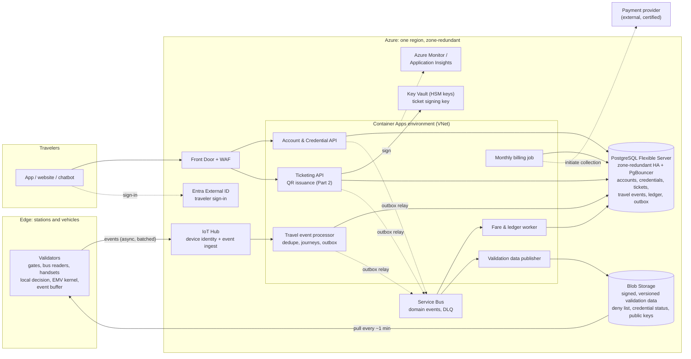

# 1. Cloud infrastructure

Azure, one region with zone redundancy, a second region for disaster recovery. Conceptual design, not deployed.

## Services and why

| Service | Role | Why |
|---|---|---|
| Container Apps | All APIs, workers, billing job | Autoscaling containers without running Kubernetes |
| PostgreSQL Flexible Server | Central database: accounts, credentials, tickets, events, ledger, outbox | Transactions and unique constraints keep money and tickets correct |
| IoT Hub | Per-device identity, receives validator events | Built for large device fleets; a stolen device can be disabled |
| Service Bus | Business events published from outboxes, dead-letter queues | Reliable, retryable messaging between services |
| Blob Storage | Signed, versioned validation data that validators download | Cheap and highly available; devices pull, the cloud never needs to reach every device |
| Key Vault (HSM) | Ticket signing key | Private key never leaves the HSM |
| Front Door + WAF | Public entry point | TLS, DDoS protection, rate limiting |
| Entra External ID | Traveler sign-in | Managed identity provider |
| Azure Monitor | Metrics, logs, alerts | Queue lag, validator data age, latency, database connections |

## Accounts, credentials and tickets

- **The cloud database is the source of truth** for accounts, credentials, ticket entitlements, travel events and the ledger.
- **NFC credentials** (bank card, phone wallet, transit card) link to one account. For bank cards we store the payment provider's card reference, not card data. Raw card data (such as the card number) is not stored by our application.
- **Bank-card acceptance relies on a certified EMV payment kernel** in the validator and a payment-provider integration. Their internals are out of scope. A static NFC identifier is not treated as proof that a card is genuine.
- **QR credentials** carry signed claims for one ticket (Part 2). The ticket record itself stays in the cloud.
- **Temporary account:** created on the first tap of an unknown bank card, or when buying a QR ticket without signing in. It can later be claimed by a registered account.
- **Lost card:** block the credential, add a new one. Tickets and balance stay in the account.

## Boarding: local validation and its limits

**Normal path** (proposed target: decision under 300 ms). No network call on the decision path:

- **QR:** verify the signature with a published public key, check the validity window against the validator's clock, check the local deny list.
- **NFC:** the EMV kernel performs the card-level check; the validator looks up the credential reference in its local status list.
- The tap is stored on the device as an event with a unique ID and uploaded later.

**Validation data** (deny list, credential status, public keys):

- Published by the cloud as signed, versioned files; validators pull about every minute.
- A validator verifies the signature, accepts only a newer version than it already has (rollback protection), and records how old its data is.
- New public keys are published before the ticketing service starts signing with them.
- Validator clocks are synchronized (network time at stations, GNSS on vehicles), because QR windows are checked against them. What matters is clock uncertainty: briefly losing synchronization need not change anything while the estimated error stays within tolerance.

**Limits:** a decision is only as current as the local data. A revocation reaches a connected validator at its next refresh (about a minute); an offline validator does not see it until it reconnects.

### Proposed operator risk policy

These are proposed defaults for the operator to accept or change, not established requirements.

| Situation | Proposed behavior |
|---|---|
| Unknown bank card, validation data up to 30 min old | Board if the EMV card check passes. Payment authorization with the provider happens after upload. **Boarding permission is not a successful payment.** |
| Payment authorization later declined | The journey stays as debt on the (temporary) account. The card reference goes on the deny list and is refused at the next refresh until the debt is settled. |
| Validation data older than 30 min | QR: accepted if the signature and window are valid and it is not on the last known deny list. Known, active NFC credentials: accepted. **Unknown bank cards: refused** ("use another ticket or ask staff"). The validator raises an alert. |
| Clock uncertainty above the permitted tolerance | The validator cannot reliably validate time-limited QR credentials. It **refuses automatic QR acceptance** and directs the traveler to staff or another supported credential. NFC acceptance follows the stale-data rules above. Flagged for maintenance. |

Consequence: a long outage affects boarding as well as billing. First-time bank-card travelers are refused, and revocations since the last refresh are not applied. An operator could accept unknown cards for longer in exchange for more unpaid journeys.

## Central accounting and the monthly bill

1. **Ingest.** The event processor reads a batch from IoT Hub. In **one database transaction** it inserts each event (unique event ID, duplicates skipped), updates journeys, and writes outbox rows for resulting business events such as `JourneyCompleted`. Only after the commit does it record its read position in IoT Hub. A crash before that means the batch is read again and duplicates are skipped.
2. **Journeys.** Check-in and check-out are paired. A check-in without check-out becomes an *incomplete journey*.
3. **Ledger.** The fare worker takes `JourneyCompleted` from Service Bus, calculates the charge and writes append-only ledger entries in cents, each with a unique cause key (journey plus entry type). It commits, then completes the message. A redelivered message hits the unique key, so there is no second charge. Corrections are new entries, never edits.
4. **Invoice and collection.** For monthly-billed accounts, the billing job closes the period, finalizes the invoice and initiates collection through the payment provider. Before that, amounts are *provisional*. Bank-card payment authorization and settlement follow a separate provider flow.

### Reliable delivery is not the same as duplicate protection

- **Reliable delivery (nothing lost):** state and outbox row are committed together; a relay publishes pending rows and retries until Service Bus confirms, then marks them sent. Incoming messages are acknowledged only after the consumer's transaction commits. Messages that keep failing go to a dead-letter queue with an alert.
- **Duplicate protection (nothing applied twice):** unique event IDs and business keys in the database. Service Bus duplicate detection (message ID = outbox row ID) is an extra filter within its time window, not a guarantee.
- The same pattern applies to the Account & Credential API and the Ticketing API (`CredentialBlocked`, `TicketIssued`).

Delivery is at least once and effects are idempotent. The design does not rely on "exactly once".

## Scaling during rush hours

- Validators decide locally, so peak cloud load is event ingest, app traffic and fare processing, not boarding decisions.
- **Pre-scale** before the known peaks (e.g. 07:00 and 16:30), because reactive autoscaling takes minutes.
- Minimum replicas on user-facing APIs reduce cold-start latency.
- **PgBouncer and connection caps** protect PostgreSQL. When workers are at their limit, work waits in IoT Hub or Service Bus instead of overloading the database.

## Security, resilience, performance

- **Security:** account always taken from the login token; per-device certificates for validators; managed identities, no secrets in code; private network for the database; QR credentials and validation data are signed; raw card data not stored by our application.
- **Resilience, three separate layers:** zone failure (automatic failover), region failure (declared failover to a second region), backups (for corruption or mistakes).
- **During an outage:** validators keep deciding locally. For the first 30 minutes (proposed) behavior is normal; after that the stale-data rules above apply. Billing catches up from buffered events after recovery.
