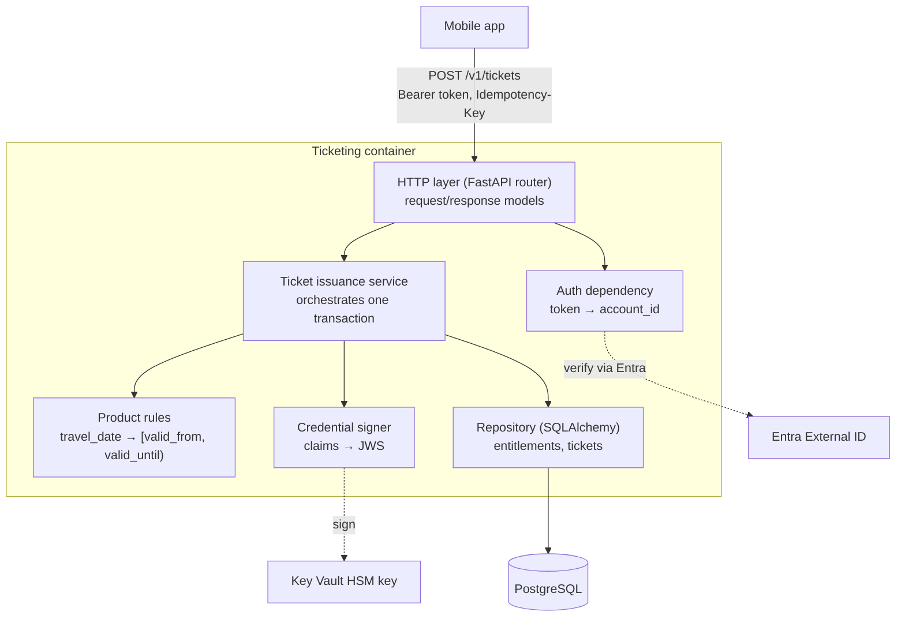

# 2. QR-ticket service

A container app that turns a paid entitlement into a QR ticket valid for a specific window, for example **a day ticket for 2 January 2027**.

The cloud database holds the **authoritative ticket record**. The QR code carries a **signed copy** of the ticket's product and validity claims, so a validator can check it offline.

## Three separate guarantees

| Guarantee | How |
|---|---|
| **Unique** | Random ticket ID (UUIDv4) plus a database constraint: one ticket per entitlement |
| **Authentic** | Digital signature (ES256). Validators verify it offline with the public key. A signature prevents **modification**, not copying or sharing |
| **Authorized** | Account taken from the login token; the entitlement must belong to that account |

## Why a signed QR, not an opaque ID

- An opaque random ID needs either an online lookup or a preloaded list of every valid ticket on every validator. A signed credential needs only a few public keys and a small deny list.
- **Copies still verify.** A screenshot or photocopy passes the signature check. Mitigations: short validity windows, the deny list, and detecting the same ticket ID at two places after upload. Offline replay can be limited, not prevented.
- **Revocation latency:** about one minute for a connected validator (next refresh); for an offline validator, not until it reconnects.
- **Keys:** every credential carries a key ID (`kid`). New public keys reach validators before signing starts; old ones are kept until the last ticket signed with them has expired.
- The QR contains no personal data: ticket ID, product, valid-from, valid-until, key ID.

## Code components



Dotted lines are production integrations; the example code uses development stand-ins (Part 3).

## Validity window

The app sends a **date**; the server computes the window.

- 2 January 2027 → valid from `2027-01-01T23:00:00Z` until `2027-01-02T23:00:00Z` (Amsterdam midnight to midnight, stored in UTC).
- The end is exclusive. Daylight-saving days last 23 or 25 hours, handled by the time zone library.
- Travel dates from today up to 60 days ahead are accepted (assumption).
- Validators compare the window against their own clock, so clock synchronization matters (Part 1).

## API

What the phone app calls:

```text
createTicket(entitlementId, travelDate, idempotencyKey) -> Ticket
```

**Request**

```http
POST /v1/tickets
Authorization: Bearer <token>
Idempotency-Key: 5f1c2b1e-8d7a-4a55-9a0e-3b3f6d2c9e11

{
  "entitlement_id": "2d9f7a4e-6b0c-4f3e-8a1d-7c5e9b2a4f60",
  "travel_date": "2027-01-02"
}
```

No account ID, product or timestamps in the body: the server derives them. Unknown fields are rejected.

**Response `201 Created`**

```json
{
  "ticket_id": "8b0e5f0a-3c1d-4f7e-9a51-2d6c9e4b7a10",
  "entitlement_id": "2d9f7a4e-6b0c-4f3e-8a1d-7c5e9b2a4f60",
  "product_code": "DAY_2ND",
  "travel_date": "2027-01-02",
  "valid_from": "2027-01-01T23:00:00Z",
  "valid_until": "2027-01-02T23:00:00Z",
  "status": "issued",
  "credential": {
    "format": "jws-es256",
    "kid": "tix-2027-01",
    "value": "eyJhbGciOiJFUzI1NiIs..."
  },
  "created_at": "2026-12-20T10:30:00Z"
}
```

The app shows `credential.value` as the QR code. A replay of an earlier request returns the same body with header `Idempotent-Replayed: true`.

**Errors** (`application/problem+json`)

| Status | When |
|---|---|
| `400` | `Idempotency-Key` missing or longer than 100 characters |
| `401` | Not signed in |
| `404` | Entitlement (or, for `GET`, ticket) not found or belonging to another account; same answer for both |
| `409` | `idempotency-key-conflict`: same key reused with a different body |
| `409` | `entitlement-already-used`: different key, but the entitlement already has a ticket; the response includes its `ticket_id` |
| `422` | `invalid-travel-date`: in the past or more than 60 days ahead. `invalid-request`: malformed JSON, missing or unknown fields (field locations listed, submitted values not echoed) |
| `503` | Signing failed; nothing was saved; retry with the same key |

`GET /v1/tickets/{ticket_id}` returns the same ticket again, e.g. on a new phone.

## Retries and concurrency

The response is sent only after the database commit succeeds.

| Case | Result |
|---|---|
| Retry: same key, same body | `201` with the stored ticket and identical credential bytes |
| Two identical requests at the same time | The second waits for the entitlement row lock, then finds the first request's ticket by its key and returns it (tested on PostgreSQL). Unique constraints remain as a backstop |
| Same key, different body | `409 idempotency-key-conflict` |
| Different key, entitlement already issued | `409 entitlement-already-used` |
| Signing fails | `503`, nothing saved |
| Saved, but the response was lost | Retry returns the stored ticket |

The credential is stored with the ticket because ES256 signatures differ every time; re-signing on retry would create a second valid credential.

## Libraries

| Need | Library | In the example code? |
|---|---|---|
| API | FastAPI, Pydantic | Yes |
| Database access | SQLAlchemy 2.0 | Yes |
| PostgreSQL driver | psycopg 3 | Optional `postgres` extra; used by the PostgreSQL race test |
| Migrations | Alembic | Proposed (example uses `create_all`) |
| Signing | PyJWT + cryptography | Yes, with an in-memory development key |
| Production signing | azure-keyvault-keys + azure-identity | Proposed |
| Time zones | zoneinfo + tzdata | Yes |
| Tests | pytest, httpx | Yes |
