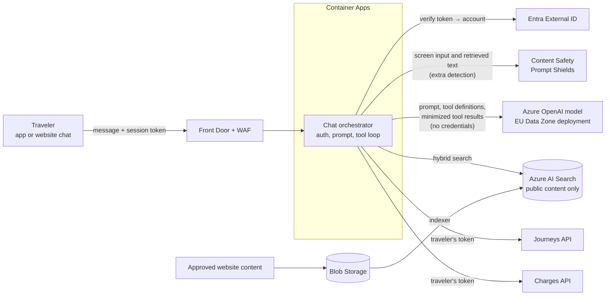

# 4. Traveler chatbot

Conceptual design, not implemented.

## Two kinds of questions, two mechanisms

| Question | Kind | How it is answered |
|---|---|---|
| How do I buy a ticket? | Public | Search over approved website content, answer with a link to the source |
| Did I forget to check out yesterday? | Personal | Tool call to the Journeys API, using the traveler's own login |
| What's my monthly bill so far? | Personal | Tool call to the Charges API, using the traveler's own login |

**Personal data never goes into the search index.** It is fetched live, per question, through the same APIs the app uses. The fields needed for the answer are then passed to the model (see Safety and privacy).

## Cloud services

| Service | Role |
|---|---|
| Container Apps | Chat orchestrator: our code handles login, tools and checks |
| Azure OpenAI (EU Data Zone) | Language model; per Microsoft's documentation, processing stays in EU regions |
| Azure AI Search | Index of public website content only |
| Blob Storage | Approved pages exported from the website |
| Entra External ID | Same login as the app |
| Content Safety (Prompt Shields) | Additional detection of prompt-injection attempts; not an access control |

## The three example questions

- **"How do I buy a ticket?"** Search public content, answer from it with a link. Works without login.
- **"Did I forget to check out yesterday?"** Asks the traveler to sign in, then fetches yesterday's journeys (Amsterdam date). Answer: *"Our records show a check-in at 17:45 with no check-out, as of 08:12."* Gate events can arrive late, so this is evidence, not certainty.
- **"What's my monthly bill so far?"** Fetches month-to-date charges. Answer: *"€87.35 so far (provisional, as of 08:10)."* Only the monthly invoice is final.

## Safety and privacy

- **The access-control boundary is server-side authorization plus a few read-only tools.** Tools have no account parameter; the orchestrator attaches the traveler's token and the API derives the account from it. The model cannot request someone else's data.
- **Credentials stay in application code.** Access tokens are never placed in the prompt or given to the model.
- **Personal data reaches the model only as needed.** It is excluded from the public index, but the fields required for an answer (e.g. yesterday's journeys, the month-to-date total) are passed to the model. Tools return only those fields.
- **Prompt Shields is an additional detection layer**, not a guarantee; it can miss attacks. Retrieved content is treated as untrusted data, and access control does not depend on the model behaving.
- Tools are read-only. The bot cannot change anything; it links to existing forms.
- If an API fails, the bot says so. It never guesses.
- **Logging and retention (what our application controls):** the orchestrator does not log message content or tool results by default and keeps conversation history only for the session. Data handling inside the model service follows the terms of the chosen Azure OpenAI deployment, to be confirmed by the privacy team.
